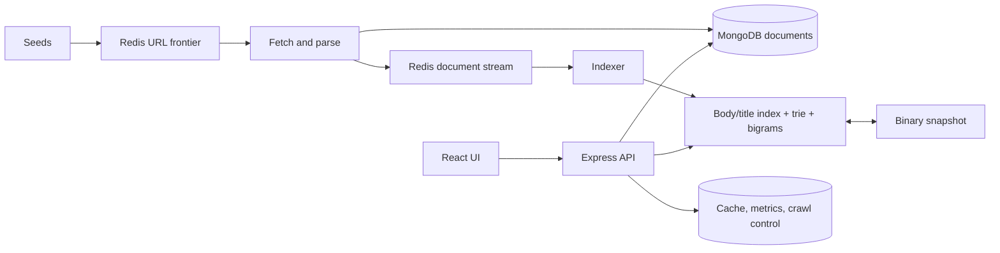

# Seekr

**A search engine built from scratch in TypeScript.** Redis-backed crawling,
positional inverted indexes, BM25 ranking, cached trie autocomplete, and spelling
suggestions. No Elasticsearch, Lucene, or Meilisearch.

[](https://github.com/ShlokMaharwal/Seekr/actions/workflows/ci.yml)

[Architecture](docs/ARCHITECTURE.md) · [Design decisions](docs/DESIGN_DECISIONS.md) ·
[Evaluation](docs/EVALUATION.md) · [Benchmarks](docs/BENCHMARKS.md) · [Verification](docs/TESTING.md)

This is a local portfolio project. Docker runs the backend; Vite runs the UI.
There is no hosted deployment.

## Features

- A Redis URL frontier with per-domain delays, atomic deduplication/checkout,
  processing leases, heartbeats, and atomic recovery of stale work.
- HTTP(S) fetching with bounded retries, robots rules, manual redirect checks,
  connection-time DNS validation, a 5 MiB response cap, and timeouts.
- MongoDB documents, full-text SHA-256 deduplication, and optional 64-bit SimHash
  near-duplicate detection with indexed candidate bands.
- Separate body/title positional indexes, incremental document replacement,
  BM25 and TF-IDF ranking, and optional BM25F title weighting.
- Implicit AND, OR, and quoted phrase queries, evaluated before top-K selection.
- A frequency-ranked trie that caches the top ten terms at every prefix node;
  the public autocomplete endpoint returns six.
- Per-term spelling suggestions using boundary-aware character bigrams and
  capped Damerau-Levenshtein distance.
- Plain-text snippets selected by a sliding window and rendered through React's
  escaping, including query highlights.
- Checksummed binary snapshots using varints and delta-encoded document ordinals
  and positions, with a loader for legacy JSON.
- A React search page, document reader, ranker comparison, and token-protected
  crawler dashboard.

## Quick start

Use **Node.js 22.17+**, npm, and Docker Desktop/Engine with Compose v2. Start the
Docker engine before running Compose.

```bash
npm ci
npm ci --prefix frontend
cp .env.example .env
cp frontend/.env.example frontend/.env
```

Set `ADMIN_TOKEN` in `.env` to a local token of your choice. Then:

```bash
docker compose up --build -d
npm run dev:frontend
```

Open [localhost:5173](http://localhost:5173). In **Dashboard**, enter the same
admin token and connect. Start a crawl with a seed such as
`https://en.wikipedia.org/wiki/Computer_science`. Search results appear as the
indexer consumes crawled documents. To explore a whole section, use a section
root such as `https://nodejs.org/en/docs/`.

The API is available at [localhost:4001](http://localhost:4001/health) with Docker.
The frontend example file already points there. Restart Vite after changing its
environment file.

### Run without Docker

Start Redis on `localhost:6379` and MongoDB on `localhost:27017`, then build:

```bash
npm run build
npm run dev:api
# In another terminal:
npm run dev:crawler
# In another terminal:
npm run dev:frontend
```

Export the root environment variables for native API/crawler processes. Set
`VITE_API_BASE_URL=http://localhost:4000` in `frontend/.env` for native API
development. Docker maps **host 4001 → container 4000**; the native API defaults
to **4000**. See [local setup](docs/LOCAL_DEVELOPMENT.md).

## Demo

```bash
docker compose up --build -d
npm run dev:frontend
```

Connect the dashboard with your token, crawl a small corpus, then demonstrate
`binary tree`, `binary OR graph`, `"binary tree"`, autocomplete, a misspelling,
ranker comparison, and an indexed document. Pause and resume from the dashboard.

**Demo GIF:** add your local screen recording here.

## Architecture



MongoDB is the document source of truth. Redis coordinates work and events. The
API serves an in-memory index and periodically saves it to disk. On startup it
loads a snapshot, streams MongoDB to reconcile changes since that snapshot, and
recovers pending stream messages. See the [page-by-page walkthrough](docs/ARCHITECTURE.md).

## How it works

### Tokenization and phrase positions

The English pipeline lowercases ASCII letters/digits, removes stopwords, and
applies a simplified Porter-style stemmer. Positions count original words,
including removed stopwords. `"binary the tree"` therefore has a different
position pattern from `"binary tree"`. Query Boolean conditions and phrase
positions are checked before ranking, so totals count every matching document
rather than only the retained heap entries.

### Ranking

Body BM25 defaults to `k1=1.2`, `b=0.75`:

```text
IDF(t)     = ln(1 + (N - df(t) + 0.5) / (df(t) + 0.5))
score(d,q) = Σ IDF(t) × tf(t,d)(k1 + 1)
                         / [tf(t,d) + k1(1 - b + b|d|/avgdl)]
```

TF-IDF uses smoothed IDF and `1 + ln(tf)`, without document-length normalization.
BM25F combines normalized title/body term frequencies before applying saturation.
Set `BM25_TITLE_WEIGHT=2` to try it; zero preserves body BM25. Results use a size-K
min-heap rather than sorting the entire scored corpus.

The [20-query evaluation over 29 Wikipedia CS articles](docs/EVALUATION.md)
measured **0.9683 nDCG@10 for default BM25** and **0.9089 for TF-IDF**. Title
weighting did not improve this small judged set, so it is opt-in. This is an
exploratory educational evaluation with incomplete judgments, not a held-out
benchmark or evidence of web-scale relevance.

### Suggestions, duplicates, and snapshots

Autocomplete reads cached winners after walking the prefix. Spelling correction
proposes changes only for zero-hit terms; it does not silently rewrite queries.
Suggestions are based on indexed stems. SimHash candidates share a 16-bit band;
Hamming distance verifies them with a configurable threshold of at most three.

Binary snapshots include document metadata, snippet text, and both positional
fields. Writes use a unique temporary file, fsync, and rename. A checksum rejects
partial/corrupt data; startup can rebuild from MongoDB. Old `index.json` snapshots
remain readable and are migrated when the default binary path is used.

## Configuration

Copy the root and frontend `.env.example` files. Never commit real `.env` files.

| Variable                | Default / purpose                                                                                        |
| ----------------------- | -------------------------------------------------------------------------------------------------------- |
| `REDIS_URL`             | `redis://localhost:6379`                                                                                 |
| `MONGO_URL`             | `mongodb://localhost:27017`, database `seekr`                                                            |
| `PORT`                  | Native API port `4000`                                                                                   |
| `LOG_LEVEL`             | `info`                                                                                                   |
| `INDEX_SNAPSHOT_PATH`   | Native `./data/index.bin`; Docker `/data/index.bin`                                                      |
| `ADMIN_TOKEN`           | Required for every `/admin/*` request when configured; missing token disables admin routes in production |
| `NODE_ENV`              | Docker uses `production`; native development uses your shell setting                                     |
| `CORS_ORIGINS`          | Comma-separated allowed origins; defaults to localhost ports 5173, 3000, 8080                            |
| `BM25_TITLE_WEIGHT`     | `0`; positive values enable BM25F (range 0–20)                                                           |
| `SIMHASH_MAX_DISTANCE`  | `3`; range -1–3, with -1 disabling near-duplicate filtering                                              |
| `SEARCH_RATE_LIMIT_MAX` | `60` searches/IP/minute; raise only for isolated benchmarks                                              |
| `VITE_API_BASE_URL`     | Frontend fallback `http://localhost:4000`; frontend example selects Docker port 4001                     |
| `VITE_USE_MOCK`         | `false`; `true` selects clearly illustrative UI fixtures                                                 |
| `SEEKR_API_URL`         | Benchmark target, default `http://localhost:4001`                                                        |
| `CRAWLER_TEST_ORIGIN`   | Exact private fixture origin, honored only with `NODE_ENV=test`; never needed for normal crawling        |

The benchmark helpers also accept `BENCH_CRAWL_SEEDS` (JSON seed array) and
`BENCH_COMMIT` (captured automatically by the isolated benchmark runner).

The dashboard stores the admin token in localStorage with an in-memory fallback
when browser storage is blocked. Redis/Mongo ports bind to loopback in Compose;
the fixture test network has no published ports or Internet access.

## API reference

| Method | Path                                         | Description                                                          |
| ------ | -------------------------------------------- | -------------------------------------------------------------------- |
| GET    | `/search?q=&page=&limit=&ranker=bm25\|tfidf` | `{ total, tookMs, didYouMean?, results[] }`                          |
| GET    | `/autocomplete?q=`                           | `{ suggestions: string[] }`, up to six terms                         |
| GET    | `/doc/:id`                                   | Stored document and cleaned text                                     |
| GET    | `/health`                                    | Process health; not a deep dependency readiness check                |
| GET    | `/admin/stats`                               | Corpus, queue, and crawl statistics                                  |
| GET    | `/admin/crawl/feed`                          | Recent crawl events                                                  |
| GET    | `/admin/metrics`                             | Query latency, crawl buckets, and top queries                        |
| POST   | `/admin/crawl/start`                         | `{ seeds, maxPages, delayMs, workers }`; also resumes a paused crawl |
| POST   | `/admin/crawl/pause`                         | Pause the active crawl                                               |
| POST   | `/admin/crawl/stop`                          | Stop processing and reset the frontier                               |

Admin requests require `Authorization: Bearer <ADMIN_TOKEN>`. In tokenless native
development they are permitted with a warning. Query caps are 500 characters,
pages 1–1000, and limits 1–50. Crawl seeds are HTTP(S) URLs, capped at 100;
workers are 1–10. Autocomplete inputs are capped at 100 characters.

## Tests and benchmarks

```bash
npm run build
npm test
npm run test:coverage
npm run build:frontend
npm run test:frontend
npm run lint
npm run format:check
npm run test:e2e          # requires a working Docker engine

node bench/eval/prepare.mjs
npm run bench:eval
npm run bench:micro
npm run bench:stack       # isolated Redis/Mongo + generated HTTP fixture
npm run bench             # writes docs/BENCHMARKS.md
```

Core coverage measured **98.26% lines, 94.26% statements, 97.79% functions,
83.33% branches**. CI checks Node 22 builds, lint, format, backend/frontend tests,
coverage thresholds, a real Redis/Mongo fixture E2E run, and fixture benchmarks.

All recorded throughput, p50/p95/p99, worker concurrency, memory, disk-size, and
load-time results live in [BENCHMARKS.md](docs/BENCHMARKS.md), with their date,
machine, corpus, and commit. The generated fixture and Wikipedia corpus are
different workloads. Neither is a claim about Internet crawl throughput.
Raw reference fixture measurements are retained in `bench/results/`.

## Project structure

```text
packages/core/   Algorithms, shared types, binary/legacy snapshot codecs, tests
apps/api/        Express routes, index manager, cache, metrics, Mongo read side
apps/crawler/    Frontier, worker, fetch/robots/parser, Mongo write side
frontend/        React 19, Vite, TanStack Start/Router/Query, Tailwind
bench/          Judgments, evaluation, microbenchmarks, service benchmarks
tests/e2e/      Isolated Docker fixture and process-level integration tests
scripts/        Local tooling and test/benchmark orchestration
docs/           Architecture, design, evaluation, verification, measured results
```

## Limitations and roadmap

- The whole index and snippet text live in one API process. Corpus size is bounded
  by RAM; no million-document capacity claim is made from these small tests.
- CPU-heavy scoring/indexing shares Node's event loop with HTTP handling.
- Phrase matching preserves stem order and stopword gaps, but removed stopword
  identities are not stored. Unicode tokenization, field-specific phrase operators,
  NOT, parentheses, and semantic/vector retrieval are not implemented.
- The local crawl control protocol is a single shared job. Worker count means
  concurrency within a process; robust multi-job scheduling is future work.
- SimHash is a heuristic and can suppress distinct short/similar pages. It is
  applied only from 20 words upward; disable it to inspect a corpus without that filter.
- Cache entries may be stale for up to 60 seconds. Top-query counts are retained
  cumulatively, and dashboard crawl state is local to the browser session.
- A full Internet crawl and a demo recording remain manual exercises. For larger
  corpora, consider sharding, immutable disk segments, and scatter-gather retrieval.

## Contributing and license

See [CONTRIBUTING.md](CONTRIBUTING.md). MIT, copyright 2026 Shlok Maharwal.
Downloaded Wikipedia evaluation text is CC BY-SA and retains source URLs and
retrieval timestamps under ignored `data/eval/`.
