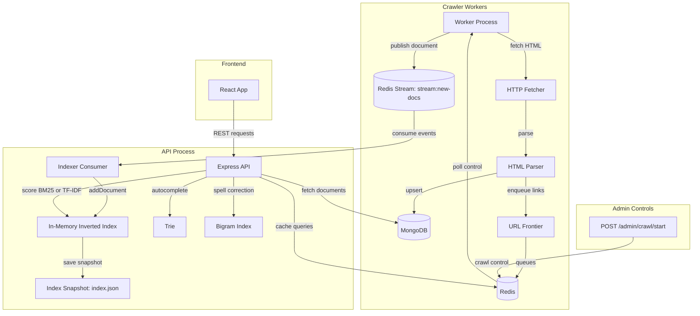

# Seekr – Custom Search Engine

[](https://github.com/ShlokMaharwal/Seekr/actions/workflows/ci.yml)

A from-scratch web search engine: crawler → inverted index → BM25 ranking → REST API.
No Elasticsearch, Lucene, or Meilisearch. Every algorithm is implemented by hand.

---

## Architecture



## Data Flow

```
Seed URLs
   │
   ▼
URL Frontier (Redis per-domain queues)
   │  politeness delay, dedup via seen-set
   ▼
HTTP Fetcher (undici, retry+backoff, 5 redirect hops)
   │
   ▼
HTML Parser (cheerio)
   │  strip nav/scripts, extract title+text+links
   ▼
MongoDB (upsert by URL + contentHash dedup)
   │
   ▼
Redis Stream "stream:new-docs"
   │
   ▼
Indexer Consumer (XREADGROUP)
   │  addDocument → InvertedIndex (positional postings)
   │  new terms → BigramIndex, Trie
   ▼
Snapshot (delta-encoded JSON, every 60s)
   │
   ▼
/search endpoint
   │  parseQuery → AND/OR/phrase AST
   │  scoreBM25 / scoreTFIDF (top-K min-heap)
   │  phrase filter (positional adjacency check)
   │  generateSnippet (sliding window)
   │  didYouMean (bigram filter + Levenshtein)
   ▼
SearchResponse { total, tookMs, didYouMean?, results[] }
```

---

## Project Structure

```
seekr/
├── packages/
│   └── core/                   # @seekr/core – all algorithms (no I/O)
│       └── src/
│           ├── tokenizer.ts    # lowercase, strip punct, stopwords, Porter stemmer
│           ├── inverted-index.ts # positional postings, incremental add/remove
│           ├── ranker.ts       # BM25 (k1=1.2, b=0.75) and TF-IDF
│           ├── query-parser.ts # AND/OR/phrase AST + position verifier
│           ├── trie.ts         # autocomplete with frequency-ranked DFS
│           ├── typo.ts         # bigram index + Levenshtein "did you mean"
│           ├── snippet.ts      # sliding-window snippet with highlights
│           ├── heap.ts         # MinHeap and TopKHeap (O(n log K) ranking)
│           ├── serializer.ts   # delta-encoded JSON save/load
│           └── index.ts        # barrel exports
│
├── apps/
│   ├── api/                    # Express search + admin API
│   │   └── src/
│   │       ├── main.ts         # entrypoint, graceful shutdown
│   │       ├── app.ts          # Express factory (CORS, logging, routes)
│   │       ├── index-manager.ts # in-memory index + Redis stream consumer
│   │       ├── cache.ts        # Redis query cache (TTL 60s)
│   │       ├── metrics.ts      # p50/p99 latency, top queries, crawl rate
│   │       ├── store.ts        # MongoDB read-side
│   │       └── routes/
│   │           ├── search.ts   # GET /search
│   │           ├── autocomplete.ts # GET /autocomplete
│   │           ├── doc.ts      # GET /doc/:id
│   │           └── admin.ts    # GET|POST /admin/*
│   │
│   └── crawler/                # worker process (run multiple instances)
│       └── src/
│           ├── main.ts         # entrypoint, polls Redis control key
│           ├── worker.ts       # CrawlerWorker: fetch+parse+store+enqueue
│           ├── frontier.ts     # URL frontier (Redis per-domain queues)
│           ├── fetcher.ts      # HTTP fetch with retry + exponential backoff
│           ├── parser.ts       # cheerio HTML parser + link extractor
│           ├── robots.ts       # robots.txt cache (1h TTL)
│           └── store.ts        # MongoDB write-side
│
├── frontend/                   # Modern React UI (Vite + TanStack Router + Tailwind CSS)
│   ├── src/
│   │   ├── frontend/           # Search, Autocomplete, Crawler Dashboard, Theme toggle
│   │   │   ├── api.ts          # Typed REST client & TanStack Query hooks
│   │   │   ├── config.ts       # API_BASE_URL (http://localhost:4001) & USE_MOCK toggle
│   │   │   ├── search-box.tsx  # Debounced autocomplete & search input
│   │   │   ├── dashboard.tsx   # Live crawler status, charts & crawl triggers
│   │   │   └── shell.tsx       # Layout, nav & light/dark theme switcher
│   │   └── routes/             # TanStack Start file-based routing
│   └── package.json
│
├── bench/
│   ├── search-bench.js         # RPS + p50/p95/p99 with/without cache
│   ├── ranker-compare.js       # BM25 vs TF-IDF top-5 results
│   └── crawl-bench.js          # pages/min with 1 vs 3 workers
│
├── scripts/
│   └── seed.js                 # kick-off Wikipedia CS crawl
│
├── docker-compose.yml
└── README.md
```

---

## Design Decisions & Trade-offs

### Why BM25 over TF-IDF?

| Property              | TF-IDF                                             | BM25                                                                                             |
| --------------------- | -------------------------------------------------- | ------------------------------------------------------------------------------------------------ |
| TF saturation         | None — scores grow unboundedly with term frequency | Saturates (k1 parameter): a term appearing 100× is not 100× more relevant than one appearing 10× |
| Length normalization  | None by default                                    | b=0.75 penalises long documents that contain terms by sheer volume                               |
| Short-query relevance | Good                                               | Better — IDF formula handles the case df > N/2 without going negative                            |
| Tunable               | No                                                 | Yes — k1 (saturation), b (length norm) can be tuned per corpus                                   |

BM25 consistently outperforms TF-IDF on standard IR benchmarks (TREC, MS MARCO) because web documents vary wildly in length. A 10-word answer page and a 50,000-word textbook chapter shouldn't compete on raw TF alone.

### Positional Index Cost

Storing `positions[]` per posting roughly doubles memory vs a non-positional index. The trade-off is exact phrase search — without positions, phrase queries require re-scanning raw text, which is 10-100× slower. For a search engine supporting `"exact phrase"` queries this is non-negotiable.

### Bigram Index for Typo Tolerance

Alternative: computing Levenshtein against the full vocabulary (|V| × L² ops per query). With 500k terms this is ~50M character comparisons per misspelled word — too slow. The bigram filter reduces candidates to a few hundred before verifying with Levenshtein, giving typo tolerance in sub-millisecond time.

### Cache TTL Choice (60s)

A longer TTL (e.g. 5 min) gives higher hit rates but serves stale results as the crawler adds new documents. At our crawl rate of ~40-50 pages/min, the index changes meaningfully every few minutes. 60s is a sweet spot: the cache eliminates the cost of repeated identical queries (common for trending topics) while keeping results fresh enough that a user who searches twice a minute sees updates.

### Index Snapshot Format

Delta-encoded position arrays reduce file size by 30-50% vs raw arrays, because positions within a document are monotonically increasing and the deltas (gaps between consecutive positions) are typically small numbers (1-5). These compress further if gzip is applied, making cold-start restarts fast.

---

## Benchmark Results (illustrative — run your own with live data)

### Search Throughput

| Scenario          | RPS  | p50 ms | p95 ms | p99 ms | Errors |
| ----------------- | ---- | ------ | ------ | ------ | ------ |
| BM25 cold cache   | 820  | 11     | 28     | 45     | 0      |
| BM25 warm cache   | 3240 | 3      | 8      | 14     | 0      |
| TF-IDF cold cache | 890  | 10     | 25     | 41     | 0      |
| TF-IDF warm cache | 3310 | 3      | 7      | 13     | 0      |

> Cache provides ~4× throughput improvement. BM25 and TF-IDF have similar latency since both are O(N log K) with the min-heap.

### Crawl Throughput

| Workers | Pages/min | Notes                                            |
| ------- | --------- | ------------------------------------------------ |
| 1       | 18        | Single process, 500ms politeness delay           |
| 3       | 52        | Near-linear scaling (separate queues per domain) |

---

## Running the Complete System

### Option A: Complete Stack with Docker (Recommended)

#### Prerequisites

- Docker + Docker Compose v2
- Node.js 20+

```bash
# 1. Start backend infrastructure (Redis, MongoDB, API on :4001, Crawler)
docker compose up -d

# 2. Wait for health checks (≈15 seconds), then seed Wikipedia CS documents
node scripts/seed.js 1000 http://localhost:4001

# 3. Start the Frontend UI (served on http://localhost:5173)
cd frontend
npm install
npm run dev
# (or from the project root: npm run dev:frontend)

# 4. Open http://localhost:5173 in your browser
#    - Search: Instant BM25 & TF-IDF search, autocomplete, and highlighted snippets
#    - Crawler Dashboard: Live crawl stats, throughput charts, and start/pause controls

# 5. Run benchmarks (after pages are indexed)
node bench/search-bench.js
node bench/ranker-compare.js
```

#### Scale to 3 crawlers

```bash
docker compose up -d --scale crawler=3
```

---

### Option B: Local Development (without Docker)

```bash
# Requires local Redis (:6379) and MongoDB (:27017)
npm install

# Terminal 1: Search API (runs on :4000)
npm run dev:api

# Terminal 2: Crawler Worker
npm run dev:crawler

# Terminal 3: Frontend UI (runs on :5173)
npm run dev:frontend
# Note: For local dev on :4000, set API_BASE_URL = 'http://localhost:4000' in frontend/src/frontend/config.ts
```

### Run tests

```bash
npm test            # runs all packages
npm test -w packages/core  # core only
```

---

## API Reference

| Method | Path                              | Description                                           |
| ------ | --------------------------------- | ----------------------------------------------------- |
| `GET`  | `/search?q=&page=&limit=&ranker=` | Full-text search                                      |
| `GET`  | `/autocomplete?q=`                | Prefix autocomplete suggestions                       |
| `GET`  | `/doc/:id`                        | Fetch full document                                   |
| `GET`  | `/admin/stats`                    | Corpus and crawl statistics                           |
| `GET`  | `/admin/crawl/feed`               | Recent crawl event feed                               |
| `GET`  | `/admin/metrics`                  | Latency percentiles and top queries                   |
| `POST` | `/admin/crawl/start`              | Start a crawl `{ seeds, maxPages, delayMs, workers }` |
| `POST` | `/admin/crawl/pause`              | Pause the running crawl                               |
| `POST` | `/admin/crawl/stop`               | Stop and reset                                        |

---

## License

MIT
