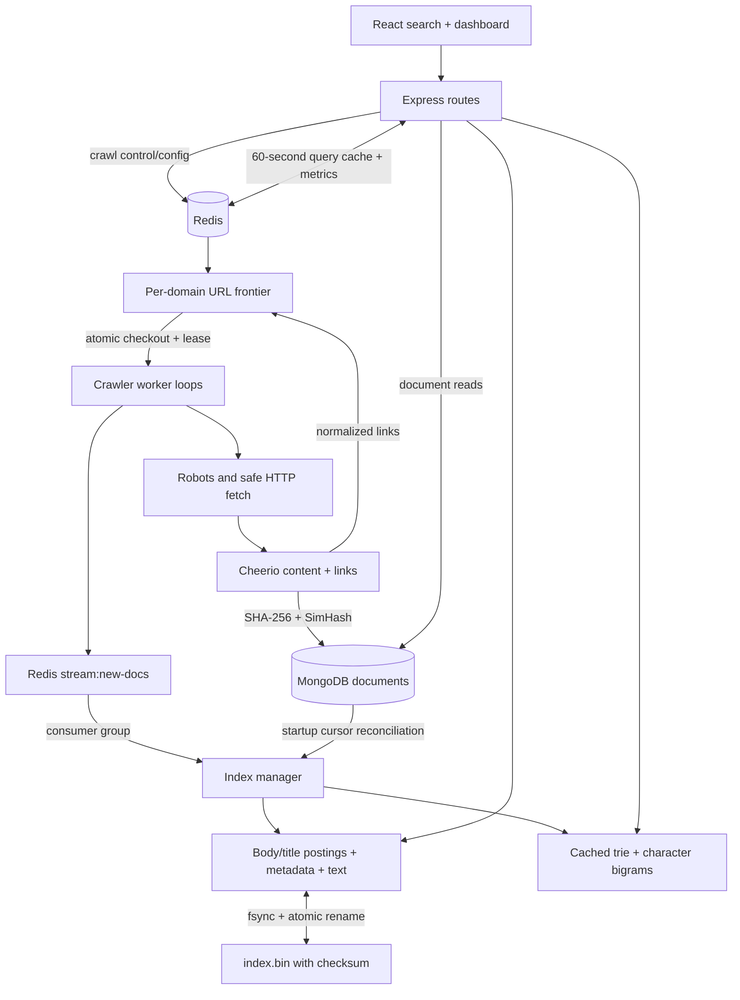

# Architecture

Seekr is a local TypeScript monorepo. MongoDB owns documents, Redis coordinates
work, and one API process owns the searchable in-memory index. The React frontend
talks to the REST API. Docker supplies the backend and persistent volumes.

## One page's journey

1. **Seed:** `/admin/crawl/start` validates HTTP(S) seeds and writes control/config
   keys. Crawler entrypoints poll those keys. The `workers` setting controls loop
   concurrency. This is one local job, not a general task scheduler.
2. **Frontier:** a Lua operation deduplicates and inserts URLs. Per-domain lists
   hold pending work; a sorted set schedules the next eligible domain. Checkout
   atomically moves a URL into a worker processing sorted set. The URL itself is
   the member, avoiding differences between Lua/JS JSON key ordering.
3. **Lease:** active URLs renew their timestamp every ten seconds. A reaper scans
   every fifteen seconds and atomically requeues entries older than sixty seconds.
   Competing reapers cannot reinsert the same entry twice. Lease-based recovery
   still provides at-least-once work, not a guarantee against every long-pause race.
4. **Fetch:** robots files and HTML both use safe HTTP(S) fetching. Every redirect
   is checked, and a custom DNS lookup validates the addresses passed to the socket
   to close the separate-preflight DNS-rebinding window. Requests have header/body
   limits, an overall timeout, a five-hop redirect cap, and a 5 MiB body cap.
5. **Parse/store:** Cheerio extracts title, main/article/body text, and normalized
   links. Links must match an allowed origin and path prefix. SHA-256 covers all
   cleaned text. SimHash uses four indexed bands followed by Hamming verification.
   Documents are upserted by URL, with a SHA-256 URL ID.
6. **Publish:** successfully stored documents are published to `stream:new-docs`.
   MongoDB upsert and Redis publication are separate operations, not a cross-store
   transaction. Startup reconciliation covers documents acknowledged after a
   snapshot or stored before a lost publication.
7. **Index:** the API uses a dedicated Redis reader connection so blocking stream
   reads do not hold up cache/control commands. Repeated document IDs replace old
   postings. New terms populate spelling candidates and cached trie suggestions.
   Malformed messages are logged, sent to a dead-letter stream where possible,
   and acknowledged.
8. **Search:** the parser produces AND/OR/phrase clauses. Set operations and phrase
   offsets find all candidates before BM25/TF-IDF scoring and top-K selection.
   BM25F optionally includes title postings. Snippet selection returns plain text;
   React escapes it while rendering highlighted matches.

## Snapshot and stream recovery

Snapshots contain metadata, full snippet text, and both positional fields. The
binary format starts with a magic/version marker and SHA-256 checksum; lengths,
document ordinals, and position gaps use unsigned base-128 varints. Unique temp
files are fsynced and renamed into place. Legacy JSON is detected from its bytes;
when the default `.bin` file is missing, the manager also tries the old `.json` path.

A missing, empty, or corrupt snapshot triggers a Mongo cursor rebuild, with batch
size 100 and progress logs. A valid snapshot is reconciled against that cursor:
unchanged text is reused, changed/new documents are indexed, and missing documents
are removed. This prevents acknowledgements newer than the snapshot from causing
permanent holes. The loaded API therefore requires MongoDB and Redis at startup.

Pending messages are read and abandoned entries are claimed in cursor batches via
`XAUTOCLAIM`. Recovery repeats every thirty seconds, so a consumer restarting before
the idle threshold does not strand a message forever. Index changes are idempotent;
transport remains at least once.

## Failure behavior

| Failure                   | Current behavior                                                                                                                                                                                     |
| ------------------------- | ---------------------------------------------------------------------------------------------------------------------------------------------------------------------------------------------------- |
| Crawler process crashes   | Processing leases remain in Redis; another running reaper can recover stale entries.                                                                                                                 |
| API process crashes       | Snapshot + Mongo reconciliation restore documents; pending stream messages are reclaimed.                                                                                                            |
| Snapshot write fails      | Error is logged; the last successful snapshot remains. Mongo is still the source of truth.                                                                                                           |
| Redis becomes unavailable | An already-loaded API can eventually serve in-memory search after cache/metric retries fail; autocomplete stays in memory. Admin/control/event operations fail. Dequeue retries until Redis returns. |
| Mongo becomes unavailable | In-memory search continues, but document/admin store reads fail. Crawler storage failures are logged; failed URLs need a frontier reset/reseed if already completed.                                 |
| Malformed stream payload  | Logged, dead-lettered where possible, and acknowledged so it cannot block the consumer forever.                                                                                                      |

The health endpoint reports process liveness, not deep dependency readiness.
Redis and MongoDB have Compose healthchecks; API startup waits for them.

## Verification and scope

The isolated Docker E2E test checks concurrent frontier consumers, competing
reapers, near-duplicate candidates in MongoDB, robots exclusions, the complete
crawl-to-search path, phrases, suggestions, cache responses, and snapshot restart.
[GitHub Actions verified the stack](https://github.com/ShlokMaharwal/Seekr/actions/runs/40010931478).
The fixture network has no Internet access. The local Windows host could not run
Docker because its daemon was unavailable; this is separate from the passing Linux run.

The index is not sharded, the control protocol is a single local job, and the
Redis stream is not a horizontally replicated API index. Adding several API
replicas in the same consumer group would split events rather than broadcast them.
